# ClimaSense 🌦️


**Seu território, mais preparado.**

O **ClimaSense** é um aplicativo desenvolvido em Flutter para aproximar informações meteorológicas do cotidiano das pessoas. Ele reúne previsão do tempo, histórico de chuvas, radar meteorológico, alertas educativos e registros de ocorrências em um único lugar, ajudando cidadãos a compreender melhor as condições climáticas de sua região.

Mais do que apresentar números, a proposta é transformar dados públicos e relatos locais em informações claras, que possam apoiar a atenção, o planejamento e a tomada de decisões humanas.

**Projeto acadêmico:** FIAP · Global Solution 2026 — 2º semestre · CitizenTech  
**Desafio:** Territory Predictive Insights  
**Versão do aplicativo:** 1.2.2

> **Importante:** o ClimaSense é uma ferramenta de apoio e educação. Seus indicadores não substituem alertas da Defesa Civil, orientações de órgãos oficiais ou avaliações técnicas de risco.

## Sumário

1. [O problema que queremos enfrentar](#1-o-problema-que-queremos-enfrentar)
2. [Equipe](#2-equipe)
3. [Conheça o aplicativo](#3-conheça-o-aplicativo)
4. [Principais funcionalidades](#4-principais-funcionalidades)
5. [Como os dados são utilizados](#5-como-os-dados-são-utilizados)
6. [Como funcionam os sinais de atenção](#6-como-funcionam-os-sinais-de-atenção)
7. [Tecnologias utilizadas](#7-tecnologias-utilizadas)
8. [Como executar o projeto](#8-como-executar-o-projeto)
9. [Privacidade e responsabilidade](#9-privacidade-e-responsabilidade)
10. [Testes e validação](#10-testes-e-validação)
11. [Versão e links do projeto](#11-versão-e-links-do-projeto)
12. [Licença e finalidade](#12-licença-e-finalidade)

## 1. O problema que queremos enfrentar

Chuvas intensas podem afetar deslocamentos, moradias, serviços e a rotina de bairros inteiros. Embora existam diversas fontes de dados meteorológicos, nem sempre é simples relacionar essas informações com situações observadas no próprio território.

O ClimaSense nasceu dessa necessidade: oferecer uma experiência acessível em que o usuário possa consultar o clima de uma cidade, acompanhar a chuva recente, visualizar sinais de atenção e registrar ocorrências que considere relevantes.

**Público-alvo:** moradores, estudantes, lideranças comunitárias e pessoas interessadas em acompanhar as condições climáticas de sua região. Os dados também podem servir como referência exploratória para discussões com gestores, sem substituir levantamentos oficiais.

**Impacto social esperado:** ampliar o acesso à informação e facilitar o acompanhamento de situações locais. O aplicativo apresenta, na tela inicial, a quantidade de bairros com registros feitos pelo próprio usuário. Esse indicador representa participação e organização dos relatos, **não** uma estimativa de pessoas protegidas ou danos evitados.

## 2. Equipe

| Integrante | RM |
|---|---|
| Fernando de Almeida Godoi Martines | 564820 |
| Gabriel Ber Soares Tarone | 563520 |
| Guilherme de Freitas Salgado | 562494 |

## 3. Conheça o aplicativo

### Início e condições meteorológicas

| Início | Clima |
|---|---|
| 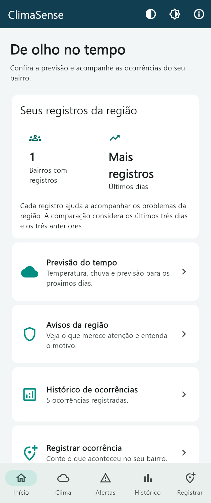 | 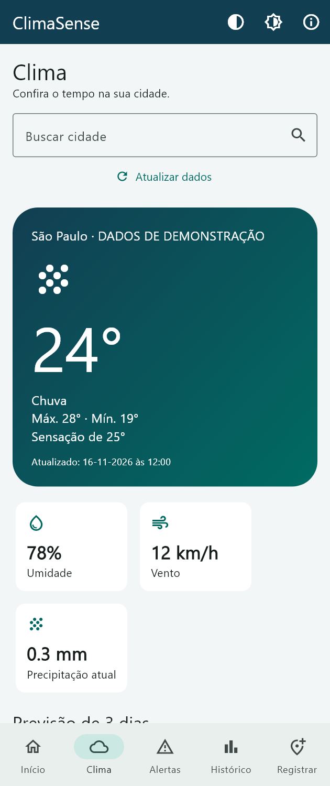 |

### Histórico de chuva e alertas

| Histórico de precipitação | Alertas |
|---|---|
| 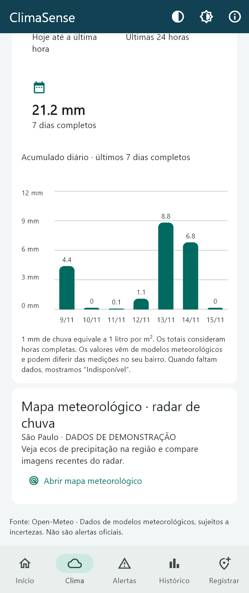 | 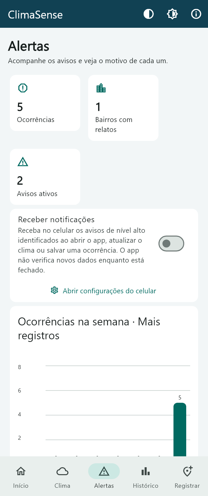 |

### Evidências e ocorrências

| Detalhes do sinal | Histórico de ocorrências |
|---|---|
| 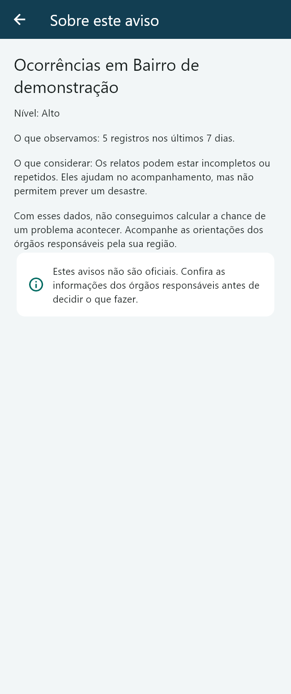 | 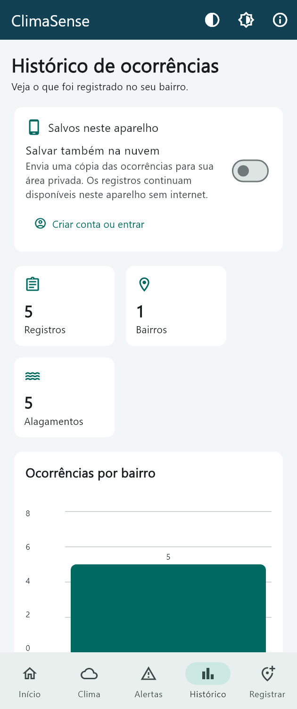 |

### Cadastro e privacidade

| Registro de ocorrência | Consentimento |
|---|---|
| 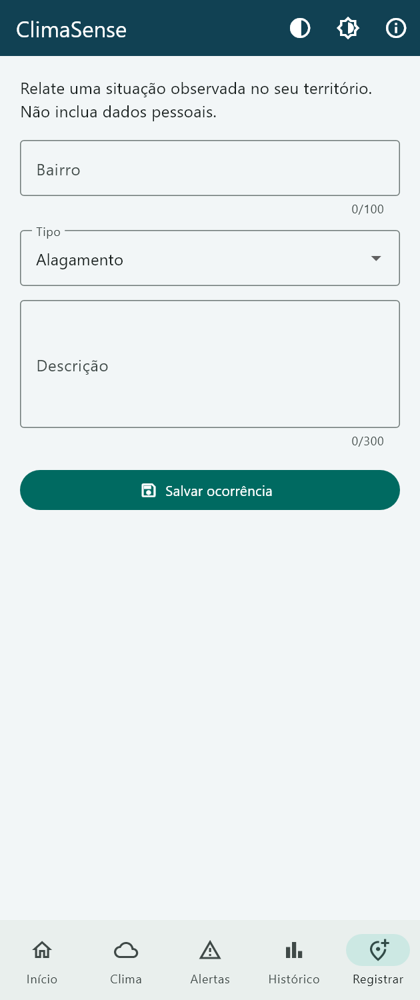 | 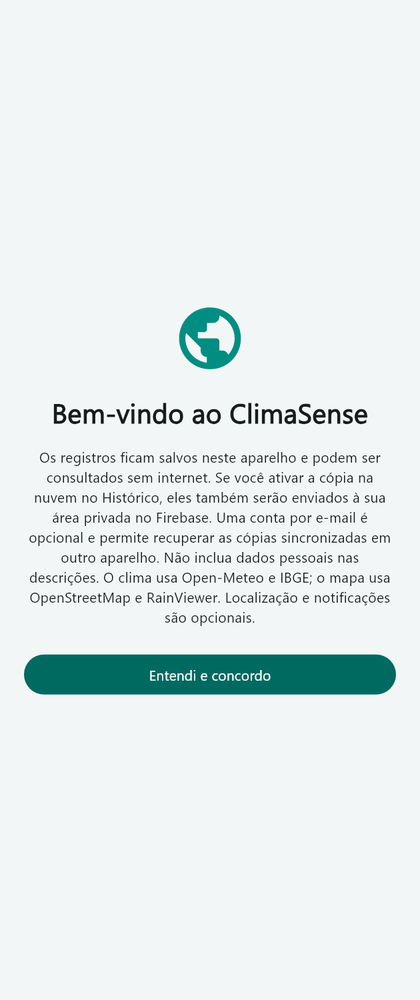 |

### Edição e conta

| Edição de ocorrência | Conta |
|---|---|
| 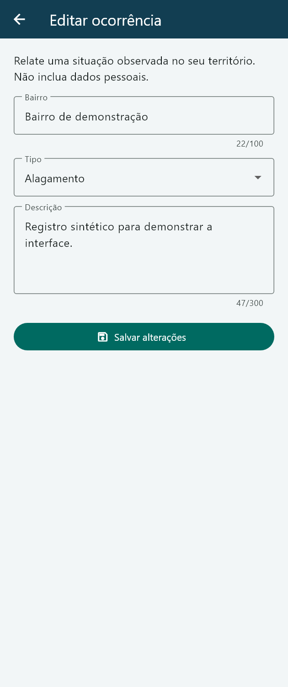 | 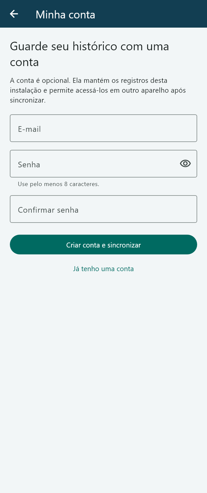 |

### Personalização visual

| Modo escuro | Alto contraste |
|---|---|
| 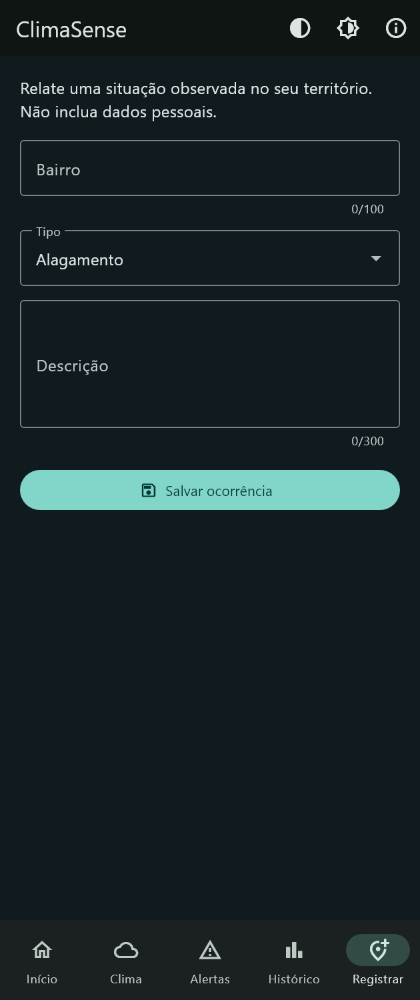 | 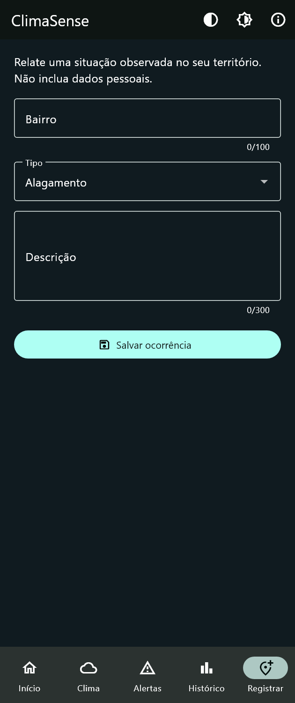 |

## 4. Principais funcionalidades

### 🌤️ Consulta do clima

- Pesquisa de cidades brasileiras com sugestões do catálogo de municípios do IBGE, inclusive quando há pequenos erros de digitação ou ausência de acentos.
- Consulta de temperatura, sensação térmica, umidade, vento e outras condições meteorológicas.
- Previsão para os próximos três dias, com precipitação e rajadas de vento.
- Cartão visual inspirado na experiência de aplicativos meteorológicos para celular.
- Localização opcional, solicitada somente quando o usuário escolhe utilizar sua região.

### 🌧️ Chuva acumulada e radar

- Acumulados de precipitação do dia atual, das últimas 24 horas e dos sete dias anteriores.
- Gráfico de colunas com a distribuição diária da chuva e informações acessíveis por toque ou mouse.
- Mapa interativo com base OpenStreetMap e imagens de radar do RainViewer.
- Consulta às imagens recentes do radar, com horário, legenda e atualização manual.
- Indicação de indisponibilidade quando a fonte não fornece dados suficientes, evitando apresentar ausência de informação como ausência de chuva.

### ⚠️ Alertas educativos

- Painel de sinais de atenção baseado em condições meteorológicas e quantidade de ocorrências registradas.
- Explicação dos critérios que motivaram cada sinal, acompanhada das evidências e limitações.
- Comparação de períodos para indicar tendência na quantidade de relatos.
- Notificações locais para determinados sinais de nível alto, mediante permissão no celular.

Os sinais são **educativos e demonstrativos**. Não são avisos oficiais, nem previsões validadas de alagamentos ou desastres.

### 📝 Registro e histórico de ocorrências

- Formulário com validação para registrar situações observadas pelo usuário.
- Consulta, edição e exclusão de registros, com confirmação antes da remoção.
- Histórico com filtros, distribuição por bairro e indicadores de participação.
- Armazenamento local, permitindo consultar e modificar registros mesmo sem internet.
- Sincronização opcional com o Firebase quando o usuário ativa a cópia na nuvem.

O histórico reúne **apenas os registros do próprio usuário**. O aplicativo não oferece um banco público compartilhado de ocorrências de todos os moradores.

### 🔐 Conta, preferências e acessibilidade

- Uso inicial sem cadastro obrigatório.
- Conta opcional por e-mail e senha, com recuperação de senha e do histórico sincronizado.
- Separação de dados entre usuários.
- Temas claro, escuro e automático, além de alto contraste.
- Interface em português brasileiro, componentes Material 3, textos de apoio e respeito à preferência de reduzir movimento.

## 5. Como os dados são utilizados

| Fonte | Utilização | Observação importante |
|---|---|---|
| [Open-Meteo](https://open-meteo.com/en/docs) | Condições atuais, previsão e histórico recente de precipitação | Dados meteorológicos modelados; não equivalem necessariamente a medições de um pluviômetro do bairro |
| [IBGE — Localidades](https://servicodados.ibge.gov.br/api/docs/localidades) | Sugestões e identificação de municípios brasileiros | Ajuda a diferenciar cidades com nomes semelhantes |
| [RainViewer](https://www.rainviewer.com/api/weather-maps-api.html) | Imagens recentes de radar meteorológico | A camada utilizada não oferece previsão futura; cobertura e disponibilidade podem variar |
| [OpenStreetMap](https://www.openstreetmap.org/copyright) | Mapa-base | Necessita de conexão para carregar os mapas |
| Registros do usuário | Histórico pessoal e sinais educativos | Informações voluntárias, sem validação independente |

**Sobre a chuva:** os acumulados são calculados a partir dos valores horários disponibilizados pela fonte, considerando o fuso da cidade consultada. O período de sete dias completos não inclui o dia atual. Horas sem dados não devem ser interpretadas automaticamente como 0 mm de chuva.

**Sobre o radar:** as imagens mostram refletividade meteorológica, que não é a mesma grandeza do acumulado de chuva em milímetros. Áreas transparentes ou sem cobertura não significam, necessariamente, tempo seco.

## 6. Como funcionam os sinais de atenção

O aplicativo utiliza regras transparentes para demonstrar como dados podem auxiliar a interpretação de situações locais.

**Relatos feitos no bairro nos últimos sete dias:**

| Quantidade de relatos | Sinal educativo |
|---|---|
| 1 a 2 | Atenção |
| 3 a 4 | Moderado |
| 5 ou mais | Alto |

**Condições previstas:**

| Condição | Sinal educativo |
|---|---|
| Precipitação diária a partir de 30 mm ou rajadas a partir de 60 km/h | Atenção |
| Precipitação diária a partir de 60 mm ou rajadas a partir de 90 km/h | Alto |

Esses valores foram adotados como **critérios ilustrativos do projeto acadêmico**. Não representam classificações oficiais de risco, nem um modelo calibrado para prever enchentes.

A confiança estatística dos sinais é apresentada como **não estimável**, pois não existe uma base própria de eventos verificados para medir a precisão do sistema. Também é importante considerar subnotificação, registros duplicados, diferenças de participação entre bairros e limitações das fontes meteorológicas.

As notificações locais são avaliadas quando o aplicativo recebe dados ou registra mudanças. **Não existe monitoramento contínuo com o aplicativo fechado nem envio remoto de alertas por SMS ou push de servidor.**

## 7. Tecnologias utilizadas

| Tecnologia | Papel no projeto |
|---|---|
| **Flutter e Dart** | Desenvolvimento da aplicação multiplataforma |
| **Material 3** | Componentes visuais, temas e acessibilidade |
| **ChangeNotifier** | Compartilhamento de estado entre partes do aplicativo |
| **http** | Requisições às APIs externas |
| **Sembast / sembast_web** | Persistência local de ocorrências e pendências de sincronização |
| **shared_preferences** | Preferências, consentimento e apoio à migração de dados |
| **Firebase Authentication** | Identidade anônima e conta opcional por e-mail |
| **Cloud Firestore** | Cópia privada e sincronização opcional dos registros |
| **flutter_map / latlong2** | Visualização do mapa e das camadas meteorológicas |
| **geolocator** | Localização mediante autorização do usuário |
| **flutter_local_notifications** | Notificações locais no dispositivo |

### Organização do código

```text
lib/
├── app/                  # Inicialização, rotas e configuração da aplicação
├── core/                 # Tema e componentes reutilizáveis
├── features/             # Telas organizadas por funcionalidade
│   ├── alertas/
│   ├── clima/
│   ├── consentimento/
│   ├── conta/
│   ├── historico/
│   ├── home/
│   └── ocorrencias/
├── models/               # Modelos de dados e regras
├── providers/            # Estado compartilhado
├── services/             # APIs, banco local, notificações e sincronização
└── main.dart             # Ponto de entrada

test/                     # Testes automatizados
firebase-tests/           # Testes das regras de acesso ao Firebase
assets/                   # Identidade visual e capturas de tela
```

O projeto separa interface, regras e acesso a dados para facilitar a manutenção e os testes. As alterações de ocorrências são salvas primeiro no banco local; quando a cópia na nuvem está habilitada, uma fila controla as pendências de sincronização. O sistema também evita que confirmações atrasadas sobrescrevam edições mais recentes.

## 8. Como executar o projeto

### Pré-requisitos

- Flutter 3.44.8, ou versão compatível com as dependências do projeto.
- Dart 3.12 ou compatível com o `pubspec.yaml`.
- VS Code ou Android Studio.
- Navegador Chrome, emulador Android ou aparelho compatível.
- Conexão com a internet para consultar as fontes meteorológicas e mapas.

### Instalação

Clone o repositório, caso tenha acesso autorizado, e entre na pasta do projeto:

```powershell
git clone https://github.com/nandoalmeidam/gs-cpad-climasense.git
cd gs-cpad-climasense
flutter pub get
```

**Executar no navegador:**

```powershell
flutter run -d chrome --web-port 7357
```

Para testar a persistência no navegador habitual, mantendo o mesmo endereço e perfil:

```powershell
flutter run -d web-server --web-port 7357
```

Abra `http://localhost:7357`.

**Executar no Android:**

```powershell
flutter devices
flutter run -d ID_DO_DISPOSITIVO
```

Substitua `ID_DO_DISPOSITIVO` pelo identificador listado no terminal.

**Gerar APK:**

```powershell
flutter build apk --release
```

O arquivo gerado ficará em:

```text
build/app/outputs/flutter-apk/app-release.apk
```

O projeto também contém um workflow de validação e geração de APK em `.github/workflows/release.yml`. A distribuição acadêmica utiliza a assinatura de desenvolvimento configurada no projeto.

### Cópia na nuvem e recuperação

As ocorrências funcionam inicialmente no banco local. Para habilitar a cópia privada, acesse **Histórico → Salvar também na nuvem**. Aguarde a confirmação de sincronização antes de trocar de aparelho.

Para recuperar registros em outro dispositivo, utilize **Histórico → Criar conta ou entrar**. Uma conta por e-mail permite recuperar os dados associados a ela. A identidade anônima, por sua vez, pode não ser recuperável após a perda da instalação original.

O projeto contém configurações públicas do Firebase para Android e web. Elas não devem ser confundidas com credenciais privadas de administração.

## 9. Privacidade e responsabilidade

O ClimaSense solicita consentimento inicial e não exige nome, telefone ou documento para o uso básico. Os registros são privados e ficam armazenados localmente, com cópia externa somente quando habilitada.

A localização é opcional: o usuário precisa acionar **“Usar minha região”**. Antes da consulta e persistência, a posição é arredondada para duas casas decimais. O aplicativo orienta a não incluir dados pessoais nas descrições das ocorrências.

O Firebase utiliza regras de acesso para separar os registros de cada identidade. O aplicativo não armazena senhas no banco de ocorrências; a autenticação é gerenciada pelo Firebase Authentication.

Os sinais exibidos são recursos de apoio à análise humana. A ausência de ocorrências não comprova ausência de risco, assim como um grande número de relatos não permite, isoladamente, estimar a probabilidade de um desastre.

## 10. Testes e validação

Para verificar o projeto localmente:

```powershell
flutter analyze
flutter test
```

**Validação da versão 1.2.2:** análise estática sem problemas, 44 testes automatizados aprovados e builds de release para Android e web concluídos. A integração com o Firebase foi validada com operações de leitura, criação, edição, exclusão, isolamento entre usuários e recuperação do histórico.

Os testes abrangem, entre outros pontos, APIs, sugestões de cidades, chuva com dados ausentes, gráficos, formulários, temas, banco local, sincronização e navegação.

## 11. Versão e links do projeto

A **versão 1.2.2** reúne as funcionalidades de clima, radar, histórico de precipitação, ocorrências, armazenamento local, sincronização opcional com Firebase, conta por e-mail, personalização visual e notificações locais. O APK preservado no projeto está em `dist/climasense-v1.2.2.apk`.

### Links do projeto

- **Repositório e código-fonte:** [ClimaSense no GitHub](https://github.com/nandoalmeidam/gs-cpad-climasense)
- **APK Android:** [`dist/climasense-v1.2.2.apk`](dist/climasense-v1.2.2.apk)
- **Capturas de tela:** [`assets/screenshots/`](assets/screenshots/)

O projeto foi desenvolvido para fins acadêmicos, com foco em consulta meteorológica, registro pessoal de ocorrências e apoio à interpretação de dados climáticos. Os sinais de atenção apresentados são educativos e não substituem comunicados oficiais.

## 12. Licença e finalidade

Projeto acadêmico desenvolvido para a **Global Solution 2026.2 da FIAP**. O material é apresentado para fins educacionais e de demonstração, respeitando as condições de uso das fontes e bibliotecas empregadas.

---

**ClimaSense — Seu território, mais preparado.**
